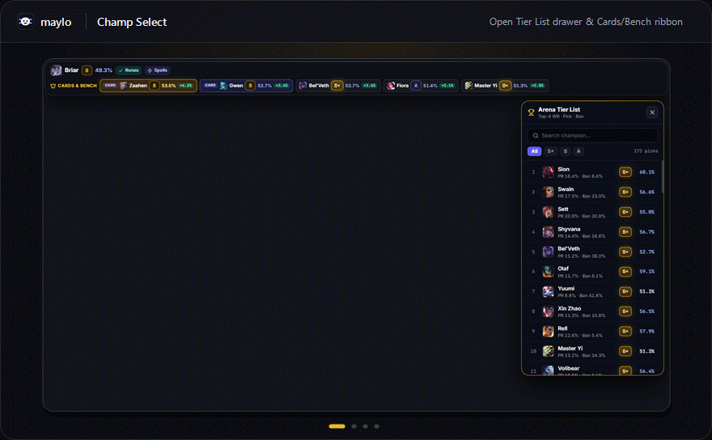

<p align="center">
  
</p>

<h3 align="center">Native Windows companion &amp; transparent in-game overlay for League of Legends</h3>

<p align="center">
  Prepare a build during champion select, check item recipes and augment tiers in game, and review your match in the Hub. Supports <strong>Summoner’s Rift</strong>, <strong>Arena 2v2</strong>, <strong>ARAM</strong> and <strong>ARAM Mayhem</strong>.
</p>

<p align="center">
  <a href="https://github.com/Lysprd/maylo-league-overlay/releases/latest"><strong>Download for Windows</strong></a>
  &nbsp;&nbsp;·&nbsp;&nbsp;
  <a href="#in-game--champ-select-overlay">Overlay</a>
  &nbsp;&nbsp;·&nbsp;&nbsp;
  <a href="#hub--arena-2v2">Hub &amp; Arena</a>
  &nbsp;&nbsp;·&nbsp;&nbsp;
  <a href="#riot-policy--vanguard">Vanguard &amp; Safety</a>
  &nbsp;&nbsp;·&nbsp;&nbsp;
  <a href="CHANGELOG.md">Changelog</a>
</p>

<p align="center">
  <sub>Windows 10 / 11 x64 &nbsp;·&nbsp; No Overwolf &nbsp;·&nbsp; No ads &nbsp;·&nbsp; Open source</sub>
</p>

<br />

## In-game & Champ Select overlay

Everything renders in a borderless click-through WebView2 layer that stays out of the way until you need it.

<p align="center">
  
</p>

- **Champ Select Tier List drawer** — pinned on the right edge of Champion Select with instant search, `All / S+ / S / A` filters, role filters in Ranked SR, and cursor-aware click-through so moving back onto the champion grid never blocks picks or bans.
- **Champion cards and bench** — the ARAM and Mayhem overlays show compact tiers on revealed cards and in the corner of recognized bench portraits. Revealed cards show a short note excerpt, and a note icon marks bench portraits with a saved note. Private mode hides both. The benchmark labels your own champion during play.
- **Alt+G reference** — browse items and their recipes, saved build variants, and the Mayhem or Arena augment catalog. Search augments by name, effect or rarity and sort by observed pick rate. The Situational tab groups shop items by effects such as armor penetration, anti-heal, burst protection and utility, with prices and recipes from Data Dragon.
- **Ranked Solo/Duo builds** — choose the variants published by U.GG for your champion, role and rank in the Hub or Alt+G. The guide keeps the published core order, shows the sample size and late-game options, and updates runes, spells and skill order with the variant.
- **Summoner’s Rift HUD** — opening items from your active guide, a configurable benchmark for CS/min, KDA, kill participation and game time, and movable panels. Preview your layout and the champion-select click area in Alt+O.

<br />

## Hub & Arena 2v2

The desktop Hub automatically follows your active queue — including Practice Tool and Custom games — and keeps Overview, Champions, Match History and Patch Notes scoped to the active mode. Champions combines the tier list and champion catalog, with a shared search and direct access to builds.

1. **Prepare your match.** Home opens the build for the champion detected in the League client. The tier list stays available during champion select. The Build page opens on the active guide, recipes and import actions. Choose a saved variant for this champion, mode and role to use it in the mini-HUD and Alt+G.
2. **Look up items and augments in game.** Alt+G opens the chosen build and its recipes. In Mayhem and Arena, search augments by effect or rarity and read their tiers within each rarity.
3. **Review your match.** Open the latest match from Home or choose one from History. Check your final items, runes and augments where available, or filter observed timeline events by items and objectives. Save a private note or open a linked local clip in your video player.

The Hub also compares recent matches, logs observed Solo/Duo rank, and reads your skin collection on request. Settings search jumps to the relevant control.

<p align="center">
  
</p>

<table>
  <tr>
    <td width="50%">
      
      <br />
      <strong>Arena 2v2</strong> — live OP.GG Top-4 %, pick &amp; ban rates, Prismatic items, Arena boots, duo synergies and CommunityDragon augments.
    </td>
    <td width="50%">
      
      <br />
      <strong>Champ Select Tier List</strong> — browse S+ picks and ban rates directly inside Champion Select without alt-tabbing.
    </td>
  </tr>
</table>

<br />

## Shortcuts

| Key | Action |
| :--- | :--- |
| `Alt+G` or `F9` | Toggle centered in-game command sheet (Build, Augments, Live Match) |
| `Tab` *(hold)* | Hover minimap `RED / BLUE` clear toggle or left HUD controls without losing game focus |
| `Ctrl+Tab` *(hold)* | Drag &amp; reposition overlay widgets |
| `Alt+O` | Edit the overlay layout for the current mode |
| `Alt+M` | Show or hide all in-game overlays |
| `Alt+L` | Open Live Match view |
| `Esc` | Close in-game sheet or Champ Select Tier List drawer |

<br />

## Riot Policy & Vanguard

Maylo is an independent project. Riot Games has not endorsed Maylo.

- Build and augment guides are reference material. The augment catalog shows effects, rarity and reported selection rates. Arena item views show pick rates where available.
- Maylo reads the local Game Client API for personal match observations. The local League Client API provides account data, match history, Solo/Duo LP and the skin inventory. Optional item and rune imports use the League Client API before play.
- The card overlay and Alt+G guide use the same champion-specific tiers, grouped by rarity. Each tier is based on the reported outcome adjusted for match count, relative to the rarity median. A question mark means the tier is unavailable. The selection rate is shown separately when reported. These changes have not yet been reviewed by Riot.

| Integration | Local endpoints |
| --- | --- |
| Game state and visible objectives | `GET /liveclientdata/allgamedata`, `GET /lol-gameflow/v1/session`, `GET /lol-gameflow/v1/gameflow-phase`, `GET /lol-lobby/v2/lobby` |
| Champion selection and reference assets | `GET /lol-champ-select/v1/session`, `GET /lol-champ-select/v1/current-champion`, `GET /lol-champ-select/v1/pickable-champion-ids`, `GET /lol-champ-select/v1/subset-champion-list`, `GET /lol-game-data/assets/v1/{champion-summary,cherry-augments,items}.json` |
| Personal review, rank, and collection | `GET /lol-summoner/v1/current-summoner`, `GET /lol-match-history/v1/products/lol/current-summoner/matches`, `GET /lol-ranked/v1/current-ranked-stats`, `GET /lol-champions/v1/inventories/{summonerId}/champions` |
| Before-match loadout import | `PATCH /lol-champ-select/v1/session/my-selection`, `GET/PUT /lol-item-sets/v1/item-sets/{summonerId}/sets`, `GET/POST /lol-perks/v1/pages`, `PUT /lol-perks/v1/pages/{id}`, `PUT /lol-perks/v1/currentpage` |

See the [Riot Developer policies](https://developer.riotgames.com/policies/general) and the [League of Legends game policy](https://developer.riotgames.com/docs/lol#game-policy).

<br />

## Install on Windows

1. Download **`MAYLO-v<version>-Setup.exe`** from the [latest release](https://github.com/Lysprd/maylo-league-overlay/releases/latest) *(requires Windows 10/11 x64 and [Edge WebView2 Runtime](https://developer.microsoft.com/microsoft-edge/webview2/))*.
2. Set League of Legends video mode to **Borderless** for the transparent in-game overlay.
3. Updates download automatically in the background with SHA-256 verification and atomic rollback — click **Restart &amp; Update** whenever you are out of a match.

For portable usage, extract `MAYLO-win-x64.zip` and run `MAYLO-Hub.exe`. See [QUICKSTART.txt](QUICKSTART.txt) for a short cheat sheet.

<details>
<summary><strong>Build from source</strong></summary>

Requires Windows 10/11 x64, Node.js 24, and .NET Framework 4.8.

```powershell
.\scripts\build-release.ps1
.\scripts\test-release.ps1
```

Compiled artifacts are written to `dist/`. The Hub, transparent overlay and installer share the React + TypeScript + Tailwind frontend in `web/src/`. Updating [`VERSION`](VERSION) on `main` triggers the [Windows release workflow](.github/workflows/release.yml).

</details>

---

<sub>[Releases](https://github.com/Lysprd/maylo-league-overlay/releases) · [Changelog](CHANGELOG.md) · [Issues](https://github.com/Lysprd/maylo-league-overlay/issues) · [MIT License](LICENSE) — maylo is an independent project and is not endorsed by or affiliated with Riot Games.</sub>
