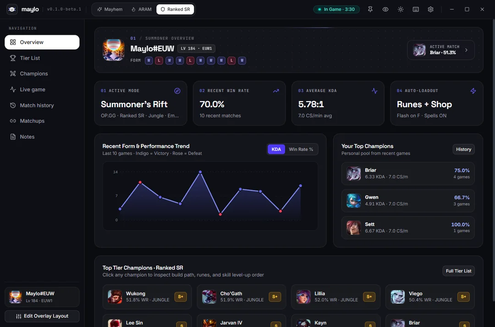
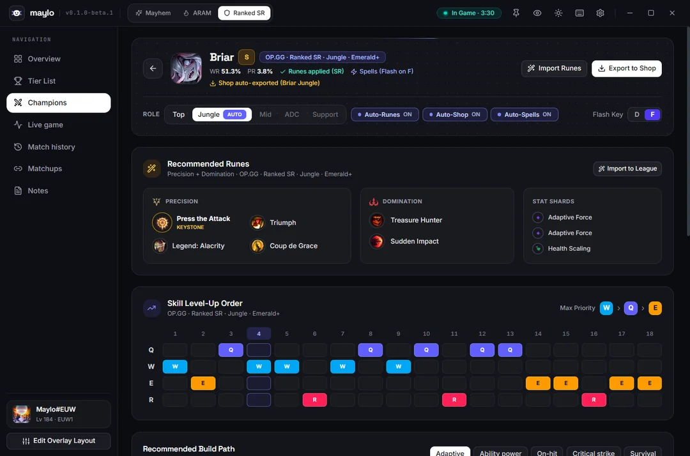
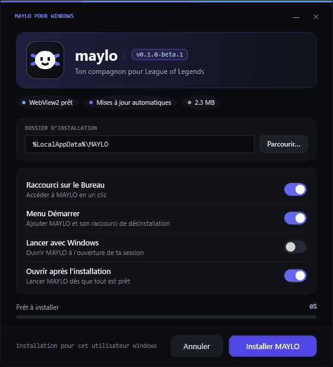

<p align="center">
  
</p>

<h1 align="center">MAYLO</h1>

<p align="center">
  <strong>Ton compagnon Windows pour League of Legends</strong><br />
  Lis tes augments, adapte ton build et garde les bonnes infos sous les yeux pendant la partie.
</p>

<p align="center">
  <a href="https://github.com/Lysprd/MAYLO/releases"><strong>Télécharger la bêta Windows</strong></a>
  · <a href="#apercus">Voir les aperçus</a>
  · <a href="https://github.com/Lysprd/MAYLO/issues">Signaler un bug</a>
</p>

<p align="center"><code>v0.1.0-beta.1</code> · Windows 10/11 x64 · MIT</p>

## Aperçus

| Le Hub | Le build du champion |
| --- | --- |
|  |  |

| Les augments en partie | L’installation Windows |
| --- | --- |
|  |  |

## En jeu

- **ARAM Mayhem** — détection OCR des titres en français et en anglais. Les badges affichent les statistiques au-dessus des cartes reconnues et restent alignés à trois, quatre ou cinq choix.
- **ARAM et Faille de l’invocateur** — builds par mode, conseils d’achat selon l’inventaire et l’équipe adverse, runes et sorts d’invocateur.
- **Overlay** — fiche détaillée en jeu, repères de minimap et panneaux déplaçables. **Alt+G** ouvre la fiche, **Alt+O** passe en mode édition et **Alt+A** force un scan des augments.

## Installer et mettre à jour

1. Dans [Releases](https://github.com/Lysprd/MAYLO/releases), télécharge **MAYLO-v…-Setup.exe** et lance-le. L’installation se fait pour ton compte Windows, sans droits administrateur.
2. Lance MAYLO depuis son raccourci. Dans League, utilise le mode **Sans bordure** pour l’overlay. Si Windows demande WebView2, l’installateur donne accès au [téléchargement Microsoft](https://developer.microsoft.com/microsoft-edge/webview2/).
3. MAYLO vérifie les releases GitHub en arrière-plan, contrôle le SHA-256 du paquet et active la mise à jour au prochain lancement. Les réglages sont conservés. L’archive portable s’utilise directement avec `MAYLO-Hub.exe` et se met à jour manuellement.

## Contribuer et publier

Depuis PowerShell sur Windows, avec Node.js 24 et .NET Framework 4.8.

```powershell
.\scripts\build-release.ps1
.\scripts\test-release.ps1
```

Le build produit le Setup et le ZIP dans `dist/`. Le fichier [VERSION](VERSION) définit la version affichée et les métadonnées Windows. Une nouvelle version dans `main`, par exemple `0.1.0-beta.2`, déclenche la [publication Windows](.github/workflows/release.yml). Une release déjà publiée garde ses fichiers. Les versions stables reçoivent les futures releases stables et les versions bêta suivent aussi les préversions.

MAYLO est un projet indépendant. Il n’est pas affilié à Riot Games. [Licence MIT](LICENSE).
