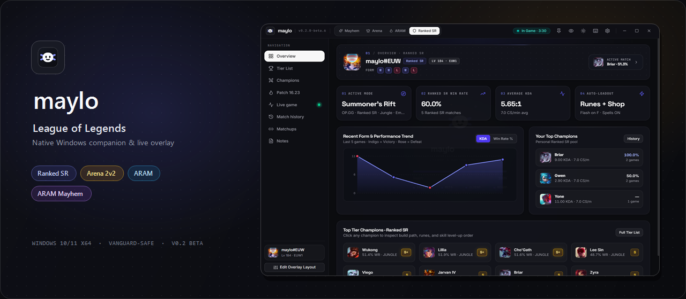
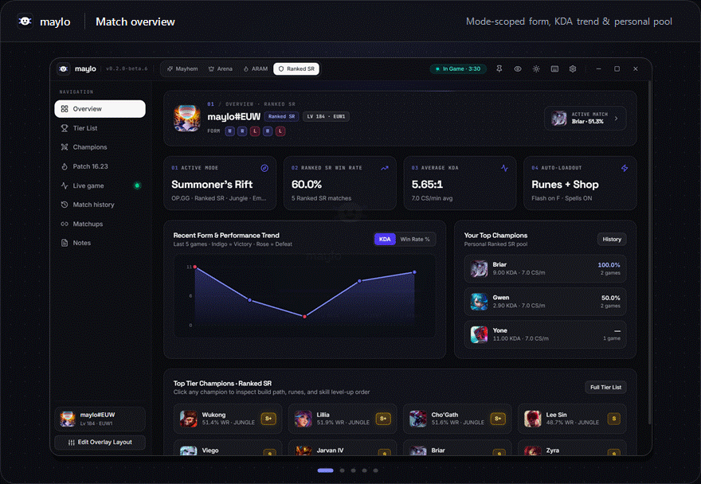
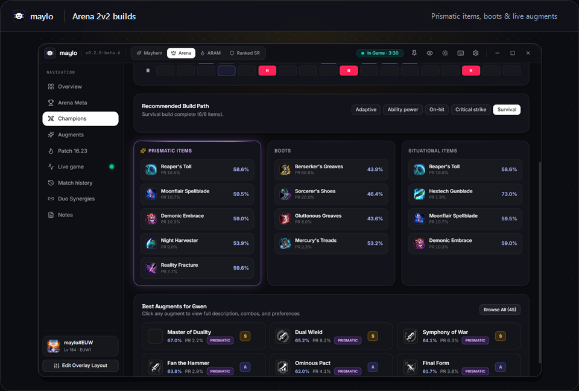
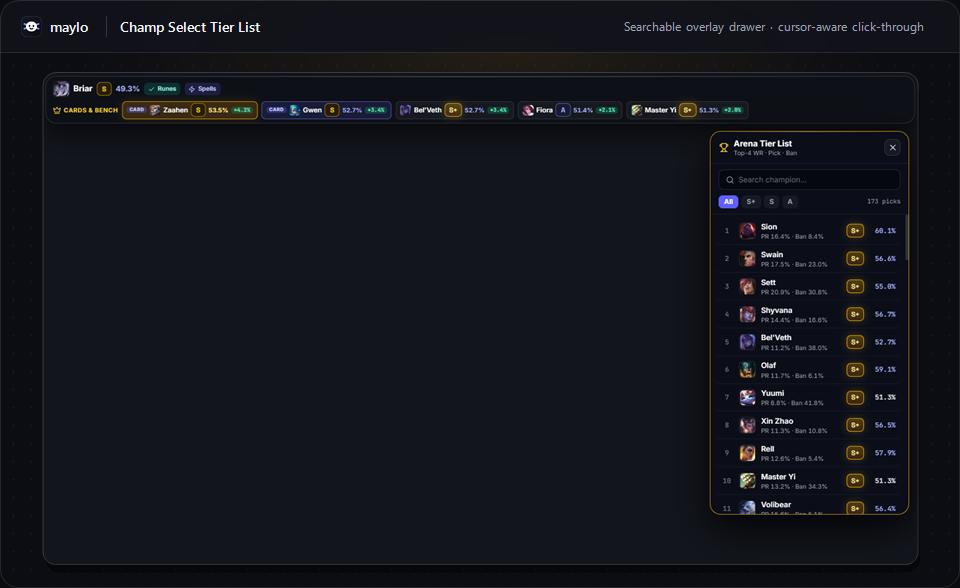

<p align="center">
  
</p>

<h3 align="center">Native Windows companion &amp; transparent in-game overlay for League of Legends</h3>

<p align="center">
  Adaptive builds, live tier lists, EN/FR augment OCR and mode-scoped stats across <strong>Summoner’s Rift</strong>, <strong>Arena 2v2</strong>, <strong>ARAM</strong> and <strong>ARAM Mayhem</strong>.
</p>

<p align="center">
  <a href="https://github.com/Lysprd/maylo-league-overlay/releases/latest"><strong>Download for Windows</strong></a>
  &nbsp;&nbsp;·&nbsp;&nbsp;
  <a href="#in-game--champ-select-overlay">Overlay</a>
  &nbsp;&nbsp;·&nbsp;&nbsp;
  <a href="#hub--arena-2v2">Hub &amp; Arena</a>
  &nbsp;&nbsp;·&nbsp;&nbsp;
  <a href="#riot-policy--vanguard">Vanguard &amp; Safety</a>
  &nbsp;&nbsp;·&nbsp;&nbsp;
  <a href="CHANGELOG.md">Changelog</a>
</p>

<p align="center">
  <sub>Windows 10 / 11 x64 &nbsp;·&nbsp; No Overwolf &nbsp;·&nbsp; No ads &nbsp;·&nbsp; Signed-free open source</sub>
</p>

<br />

## In-game & Champ Select overlay

Everything renders in a borderless click-through WebView2 layer that stays out of the way until you need it.

<p align="center">
  
</p>

- **Champ Select Tier List drawer** — pinned on the right edge of Champion Select with instant search, `All / S+ / S / A` filters, role filters in Ranked SR, and cursor-aware click-through so moving back onto the champion grid never blocks picks or bans.
- **Floating Champion Cards & Bench ranking** — ranks 2 to 5 spawned ARAM / ARAM Mayhem champion cards and bench rolls directly in Champion Select using the observed win rate for that mode.
- **EN / FR Augment OCR (ARAM Mayhem & Arena 2v2)** — detects 3 or 4 augment cards in ~75 ms, places Tier, win rate, synergy and reroll targets above each card, and dismisses cleanly on pick without triggering during rerolls.
- **Summoner’s Rift HUD** — next buy with component tracking, live CS/min & KP strip, official public objective timers, and `Tab`-hoverable `RED / BLUE` jungle clear routes while keeping the scoreboard click-through.

<br />

## Hub & Arena 2v2

The desktop Hub automatically follows your active queue — including Practice Tool and Custom games — and keeps Overview, Tier Lists, Match History and Patch Notes scoped to the active mode.

<p align="center">
  
</p>

<table>
  <tr>
    <td width="50%">
      
      <br />
      <strong>Arena 2v2</strong> — live OP.GG Top-4 %, pick &amp; ban rates, Prismatic items, Arena boots, duo synergies and CommunityDragon augments.
    </td>
    <td width="50%">
      
      <br />
      <strong>Champ Select Tier List</strong> — browse S+ picks and ban rates directly inside Champion Select without alt-tabbing.
    </td>
  </tr>
</table>

<br />

## Shortcuts

| Key | Action |
| :--- | :--- |
| `Alt+G` or `F9` | Toggle centered in-game command sheet (Build, Augments, Live Match) |
| `Tab` *(hold)* | Hover minimap `RED / BLUE` clear toggle or left HUD controls without losing game focus |
| `Ctrl+Tab` *(hold)* | Drag &amp; reposition overlay widgets |
| `Alt+O` | Toggle persistent overlay edit &amp; minimap resize mode |
| `Alt+A` | Trigger immediate Augment OCR scan |
| `Alt+M` | Show or hide all in-game overlays |
| `Alt+L` | Open Live Match view |
| `Esc` | Close in-game sheet or Champ Select Tier List drawer |

<br />

## Riot Policy & Vanguard

maylo is built to stay strictly compliant with Riot Games’ Third-Party Applications policy and Vanguard:

- **Zero memory access or hooks** — no DLL injection, no DirectX/OpenGL hooks, no kernel drivers, and no `OpenProcess` / `ReadProcessMemory` / `AttachThreadInput` calls.
- **Zero gameplay or client automation** — no simulated input (`SendInput` / `mouse_event` / `keybd_event`), no Auto-Accept, and no Enemy Summoner Spell / Ultimate cooldown tracker.
- **Official local endpoints only** — reads Riot’s local LCU &amp; Live Client Data API (`127.0.0.1:2999`) for runes, summoner spells, item-set export, scoreboard stats and public objective events, combined with standard Windows OCR for card titles.

<br />

## Install on Windows

1. Download **`MAYLO-Setup.exe`** from the [latest release](https://github.com/Lysprd/maylo-league-overlay/releases/latest) *(requires Windows 10/11 x64 and [Edge WebView2 Runtime](https://developer.microsoft.com/microsoft-edge/webview2/))*.
2. Set League of Legends video mode to **Borderless** for the transparent in-game overlay.
3. Updates download automatically in the background with SHA-256 verification and atomic rollback — click **Restart &amp; Update** whenever you are out of a match.

For portable usage, extract `MAYLO-win-x64.zip` and run `MAYLO-Hub.exe`. See [QUICKSTART.txt](QUICKSTART.txt) for a short cheat sheet.

<details>
<summary><strong>Build from source</strong></summary>

Requires Windows 10/11 x64, Node.js 24, and .NET Framework 4.8.

```powershell
.\scripts\build-release.ps1
.\scripts\test-release.ps1
```

Compiled artifacts are written to `dist/`. The Hub, transparent overlay and installer share the React + TypeScript + Tailwind frontend in `web/src/`. Updating [`VERSION`](VERSION) on `main` triggers the [Windows release workflow](.github/workflows/release.yml).

</details>

---

<sub>[Releases](https://github.com/Lysprd/maylo-league-overlay/releases) · [Changelog](CHANGELOG.md) · [Issues](https://github.com/Lysprd/maylo-league-overlay/issues) · [MIT License](LICENSE) — maylo is an independent project and is not endorsed by or affiliated with Riot Games.</sub>
