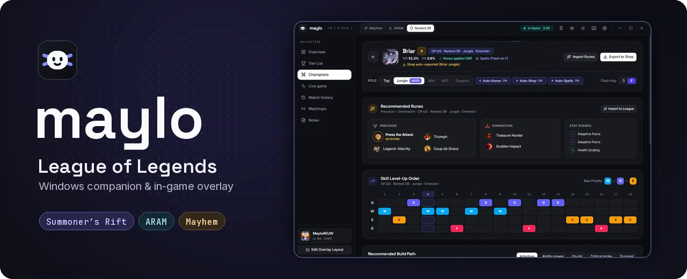

<p align="center">
  
</p>

<h1 align="center">maylo — League of Legends overlay &amp; build companion</h1>

<p align="center">
  See augment stats, adapt your build and keep match information in view while you play.
</p>

<p align="center">
  <a href="https://github.com/Lysprd/MAYLO/releases"><strong>Download the Windows beta</strong></a>
  &nbsp;·&nbsp; <a href="#aram-mayhem-overlay">See the overlay</a>
  &nbsp;·&nbsp; <a href="QUICKSTART.txt">Quick start</a>
</p>

<p align="center"><sub>Summoner’s Rift · ARAM · ARAM Mayhem · Windows 10/11 x64</sub></p>

## ARAM Mayhem overlay

maylo reads English and French augment titles and places stats above the matching cards. This simulated offer shows how a fourth badge appears while the first three stay in place.

<p align="center">
  
</p>

**Alt+G** opens the in-game sheet, **Alt+O** lets you move widgets, and **Alt+A** rescans the offer.

## Champion builds and match overview

Open a champion’s build to see runes, skill order and item suggestions that adapt to your inventory and opponents.

<p align="center">
  
</p>

The Hub shows recent matches, champion stats and tier lists.

<p align="center">
  
</p>

## Install on Windows

1. Download the setup executable from [GitHub Releases](https://github.com/Lysprd/MAYLO/releases). If WebView2 is missing, setup offers to open the [official runtime download page](https://developer.microsoft.com/microsoft-edge/webview2/).
2. Open maylo from its shortcut and use **Borderless** video mode in League for the overlay.
3. maylo downloads updates in the background, verifies their SHA-256 digest and applies them at the next launch. Your settings carry over.

<p align="center">
  
</p>

For portable use, extract the entire ZIP and run `MAYLO-Hub.exe`. The portable ZIP is updated manually.

<details>
<summary><strong>Build and release</strong></summary>

Run these commands from PowerShell on Windows with Node.js 24 and .NET Framework 4.8.

```powershell
.\scripts\build-release.ps1
.\scripts\test-release.ps1
```

Builds are written to `dist/`. The app and installer share React components in `web/src/`. Changing [VERSION](VERSION) on `main` triggers the [Windows release workflow](.github/workflows/release.yml).

</details>

[Report an issue](https://github.com/Lysprd/MAYLO/issues) · [MIT license](LICENSE)

maylo is an independent project and is not affiliated with Riot Games.
