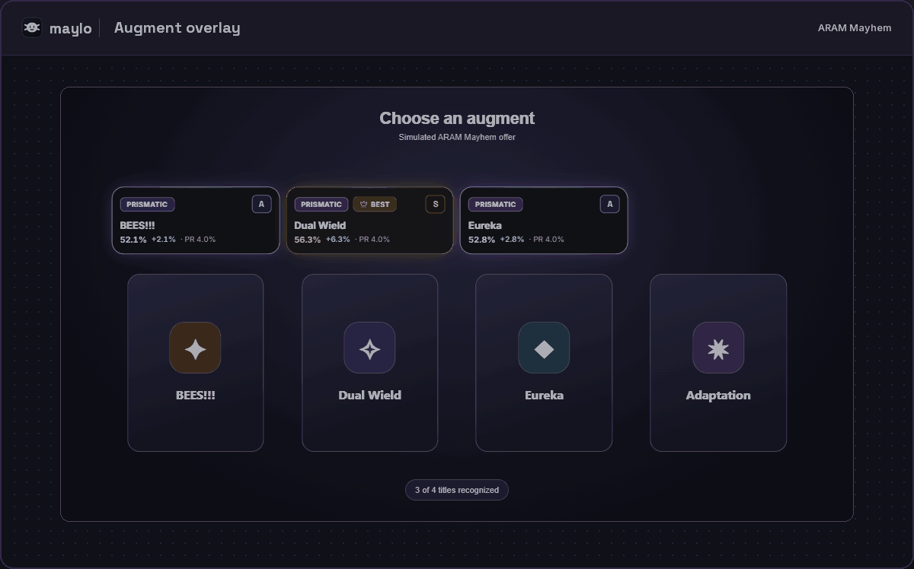
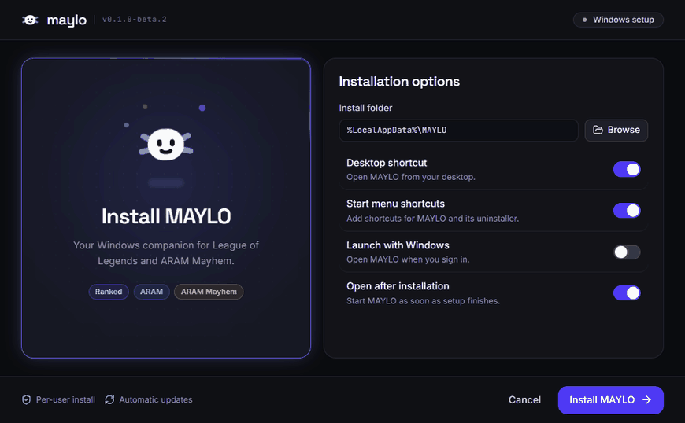

<p align="center">
  
</p>

<h1 align="center">MAYLO for League of Legends</h1>

<p align="center">
  Live build guidance, augment recognition and an in-game overlay for Summoner’s Rift, ARAM and ARAM Mayhem.
</p>

<p align="center">
  <a href="https://github.com/Lysprd/MAYLO/releases"><strong>Download the Windows beta</strong></a>
  &nbsp;·&nbsp; <a href="#in-game-overlay">See the overlay</a>
  &nbsp;·&nbsp; <a href="QUICKSTART.txt">Quick start</a>
</p>

<p align="center"><sub>Windows 10/11 x64 · Microsoft Edge WebView2 · MIT</sub></p>

## In-game overlay

In ARAM Mayhem, MAYLO reads English and French augment names and puts stats above the matching cards. The badges keep their positions while Windows OCR recovers briefly missed titles.

<p align="center">
  
</p>

Use **Alt+G** to open the match sheet, **Alt+O** to move widgets, and **Alt+A** to rescan an augment offer. The match sheet brings builds, live stats and minimap timers into view during a game.

## Hub and build guidance

| **Match overview** | **Champion builds** |
| --- | --- |
|  |  |
| Review recent matches, champion stats and tier lists. | Follow item recommendations that adapt to your inventory and opponents. Import runes and item sets into League. |

## Windows setup

1. Download the `Setup.exe` from [GitHub Releases](https://github.com/Lysprd/MAYLO/releases). Setup runs for your Windows user. If WebView2 is missing, it offers to open the [official runtime download page](https://developer.microsoft.com/microsoft-edge/webview2/).
2. Open MAYLO from its shortcut, then select **Borderless** video mode in League to enable the overlay.
3. MAYLO checks for updates in the background and verifies each package’s SHA-256 digest. Updates apply the next time you launch the app, with your settings preserved.

<p align="center">
  
</p>

For portable use, extract the full ZIP and run `MAYLO-Hub.exe`. The portable ZIP is updated manually.

<details>
<summary><strong>Build and release</strong></summary>

Run these commands from PowerShell on Windows with Node.js 24 and .NET Framework 4.8.

```powershell
.\scripts\build-release.ps1
.\scripts\test-release.ps1
```

Builds are written to `dist/`. The app and installer share React components and styles in `web/src/`. Changing [VERSION](VERSION) on `main` triggers the [Windows release workflow](.github/workflows/release.yml). Beta installations receive pre-releases and stable releases. Stable installations follow stable releases.

</details>

[Report an issue](https://github.com/Lysprd/MAYLO/issues) · [MIT license](LICENSE)

MAYLO is an independent project and is not affiliated with Riot Games.
